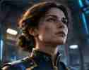
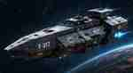
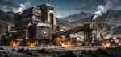
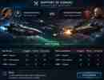
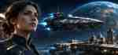
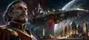

# Echosphere — Galerie de concepts (v0.1)
**Statut : exploration visuelle, non validée, non intégrée au jeu.**
Ces JPG sont des **miniatures de validation artistique à faible résolution** extraites de planches de concept art cinématographiques produites en conversation le 02/11/2026. Elles **ne sont pas les sources HD**, ne sont pas détourées et **ne doivent pas être servies au runtime**. Les données montrées dans le mockup de rapport sont fictives.

## A — Standard gratuit (réalisme orbital)

| Type | Concept |
|---|---|
| Commandant |  |
| Emblème |  |
| Frégate, classe `frigate` |  |
| Complexe d'extraction, `extraction_complex` |  |
| Planète illustrative |  |
| Exemple de rapport (non fonctionnel) |  |

## B — Premium cosmétique : opéra impérial

## C — Premium cosmétique : atlas holographique

## Statut de la collection
- `concept-v01` = proposition en cours de validation, NON jouable.
- **À produire ensuite :** assets originaux séparés et détourés, source HD, exports web optimisés, inventaire de versions et tests de lisibilité/contraste.
- Aucun pack premium ne modifie une classe, un bâtiment, une recherche, un coût, une capacité ni le renseignement.
- Voir [doc.md](doc.md) pour les décisions et [catalogue-proposition.json](catalogue-proposition.json) pour les familles canoniques.

## Risques identifiés
- Ces miniatures ne sont pas des illustrations de production ; faible résolution et découpage issu de planches.
- Certains éléments des planches de référence, notamment les effets de combat, peuvent être purement narratifs ; ils ne constituent pas des fonctionnalités.
- Un combat `v0.7` ne révèle pas les infrastructures ennemies, ni d'autres informations protégées.
