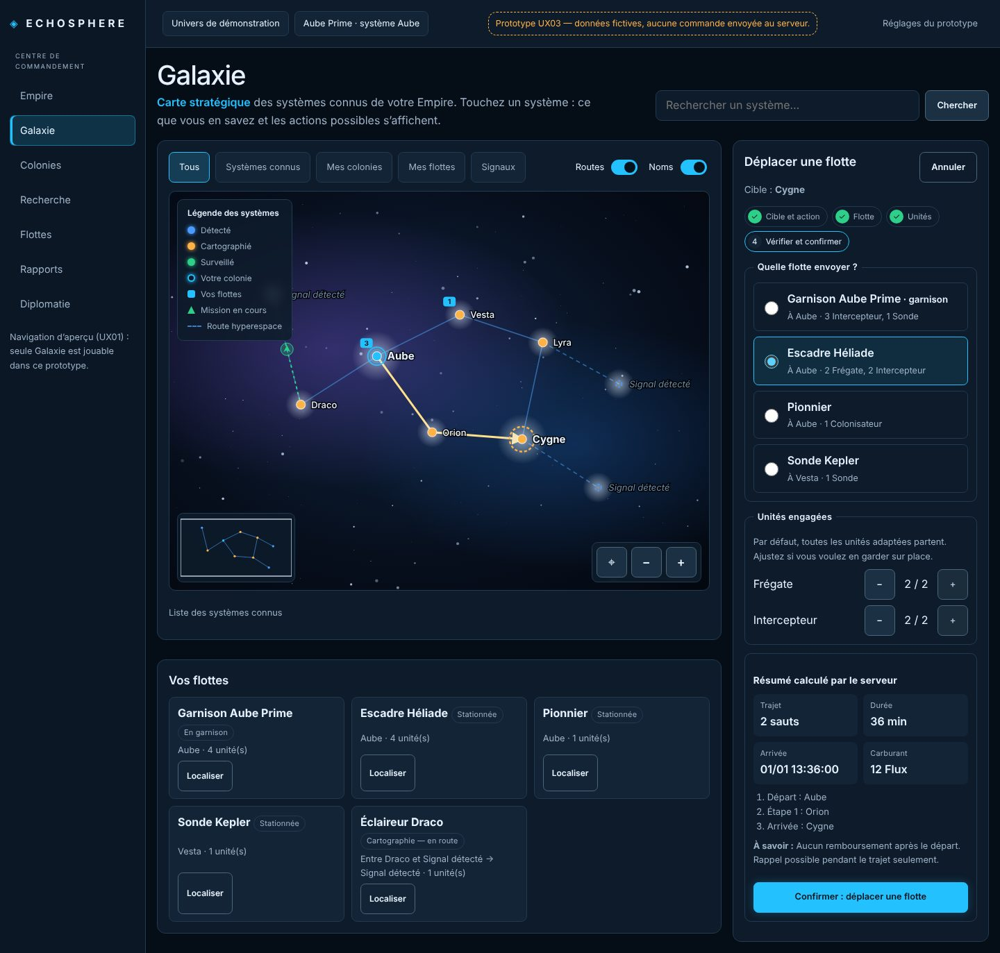
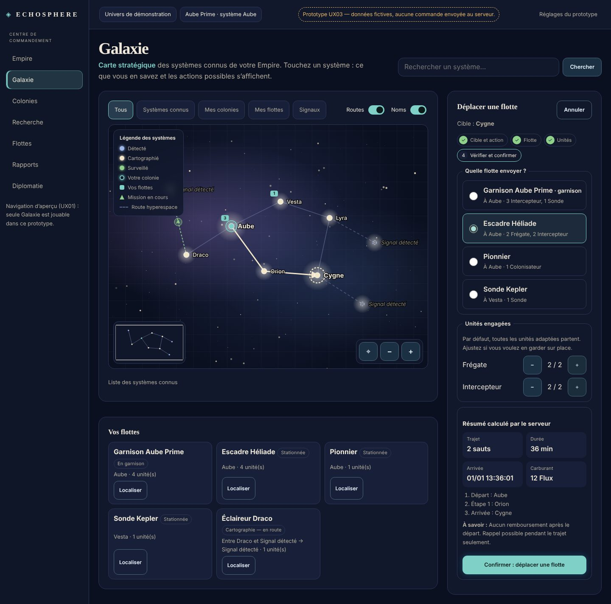
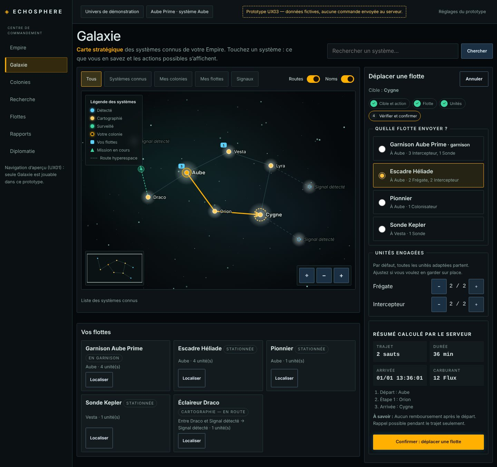

# UX02 — Directions artistiques, tokens et architecture des composants

**Statut : propositions de Claude du 03/11/2026. Aucune direction n’est déployée dans l’application :
les trois existent seulement dans le prototype UX03 (sélecteur « Direction artistique »). Validation
de l’utilisateur requise avant toute refonte graphique des écrans de production.**

Contraintes respectées : la [référence visuelle validée le 30/10/2026](../../visual-reference/README.md)
reste l’ancre (fond navy, cyan interactif, vert succès, ambre avertissement, rouge danger, violet
secondaire, densité lisible) ; l’Art Bible de la PR #18 (`art/asset-library-v01`, non fusionnée) a
retenu trois **collections d’illustrations** `realiste` (A, gratuite), `aristo` (B, premium) et
`cyber` (C, premium). Les directions ci-dessous concernent l’**interface** (chrome, panneaux, carte) ;
elles doivent accueillir les trois collections d’illustrations sans les contredire.

## 1. Trois directions d’interface

Captures : même écran, même données fictives, seul le jeu de tokens change. La direction A suit
désormais la composition et les couleurs de connaissance de `galaxy-map.png` (voir [UX03](ux03-prototype.md#alignement-sur-la-référence-galaxy-mappng-03112026-demande-de-lutilisateur)).

| | A — Console orbitale | B — Atlas stellaire | C — Pont tactique |
| --- | --- | --- | --- |
| Capture |  |  |  |
| Ambiance | Poste de commandement orbital calme, technique, lumineux sans excès | Salle des cartes d’une exploration : instruments, papier stellaire, curiosité | Passerelle de vaisseau en alerte : HUD, précision, tension |
| Palette | Navy `#050D16`, surfaces `#0E1B2A`/`#132436`, bordure `#223A52`, cyan `#23C2FF`, succès `#2ECF88`, ambre `#FFB347`, danger `#FF6B6B`, violet `#A78BFA` (= référence validée) | Encre `#0B1020`, surfaces `#11182C`, texte ivoire `#EFE8DA`, verre de mer `#7FD1C7`, or doux `#E8B86B`, corail `#F08A7A` | Noir `#06090B`, surfaces `#0D1316`, texte `#D9E7E4`, ambre de commande `#FFB000`, cyan instrument `#5AD1FF`, vert `#3CD6A0`, rouge `#FF5A5F` |
| Typographie | Sans-serif système, chiffres proportionnels | Titres serif (Georgia/Iowan), texte sans-serif | Sans-serif + chiffres monospace, libellés en capitales espacées |
| Navigation | Sidebar + barre haute (existant), carte en zone principale | Carte plein écran, navigation compacte, panneaux flottants | Barre de commandes dense, raccourcis visibles, panneaux ancrés |
| Panneaux | Cartes arrondies (12 px), bordures fines | Grands rayons (18 px), beaucoup d’air, ombres douces | Angles vifs (3 px), filets, en-têtes en capitales |
| Carte galactique | Halo navy, routes bleu acier, étoiles cyan, colonie ambre | Grille cartographique, étoiles ivoire, routes gravées | Fond noir, grille radar implicite, trajet ambre vif |
| Icônes | Pictogrammes linéaires 1,5 px arrondis | Glyphes fins inspirés des instruments anciens | Pictogrammes géométriques pleins, codes de forme |
| Densité | Moyenne (lecture en 10 minutes par jour) | Faible (immersion, sessions longues) | Élevée (joueurs experts, beaucoup d’informations) |
| Avantages | Continuité avec le shell et la référence validée ; coût faible ; lisible | Très immersif, distinctif, accueillant pour un nouveau joueur | Excellente lisibilité des chiffres ; sentiment de contrôle |
| Limites | Moins singulier | Serif à valider en petite taille ; plus de défilement ; contraste or/ivoire à surveiller | Peut intimider ; capitales moins lisibles ; risque de « clone HUD » |

## 2. Recommandation

**Direction A — Console orbitale**, enrichie de deux emprunts : la grille cartographique discrète de
B sur la carte seulement, et les chiffres tabulaires de C dans les résumés (coûts, durées). Raisons :
elle prolonge la référence validée (aucune dérive graphique non décidée, cf. AGENTS.md), elle est
la plus sûre en accessibilité (contrastes déjà vérifiés par les tests Chromium existants), et elle
laisse les illustrations des collections A/B/C porter l’identité d’Empire. B et C restent
d’excellents candidats d’**habillages d’interface** cosmétiques (voir §4).

**Décision attendue de l’utilisateur** : choisir A, B, C ou un mélange, avant d’étendre la refonte
graphique au-delà du prototype.

## 3. Tokens sémantiques

Implémentés dans `frontend/src/prototype/prototype.css` (portée `.proto-root`) ; à promouvoir dans
`style.css` seulement après validation.

| Groupe | Tokens |
| --- | --- |
| Surfaces | `--ui-bg`, `--ui-surface`, `--ui-raised`, `--ui-border` |
| Texte | `--ui-text`, `--ui-muted` |
| Intention | `--ui-primary`, `--ui-on-primary`, `--ui-success`, `--ui-warning`, `--ui-danger`, `--ui-accent` |
| Forme et rythme | `--ui-radius`, `--ui-gap` |
| Typographie | `--ui-font`, `--ui-display`, `--ui-numeric`, `--ui-label-transform`, `--ui-label-spacing` |
| Carte | `--map-bg`, `--map-route`, `--map-star`, `--map-signal`, `--map-own`, `--map-fleet`, `--map-mission`, `--map-plan`, `--map-label`, `--map-detected`, `--map-mapped`, `--map-monitored`, `--map-home`, `--map-nebula-a/b`, `--map-dust` |

Règles : un composant n’utilise que des tokens sémantiques (jamais une couleur brute) ; une
information n’est jamais portée par la seule couleur (forme, texte ou motif : signal en pointillés,
colonie entourée, trajet estimé en tirets) ; focus visible `--ui-warning` 3 px ; cibles ≥ 44 px ;
`prefers-reduced-motion` respecté.

## 4. Architecture des composants et des cosmétiques

### Composants

| Couche | Composants | État |
| --- | --- | --- |
| Primitives | `Button`, `Badge`, `Panel`, `EmptyState` (existants, `components/ui.tsx`) ; à ajouter : `Stepper`, `ChoiceCard`, `Steps`, `Facts`, `Chip`, `Notice` | Prototype : classes `proto-*` à extraire |
| Carte | `StarMap` (systèmes, routes, flottes, missions, trajet planifié, clavier) | Prototype ; à fusionner avec la carte Galaxie existante (zoom/déplacement clavier déjà présents) |
| Parcours | `MissionPlanner` (étapes flotte → unités → résumé → confirmation) | Prototype |
| Conteneurs | `CommandMap` (carte + panneau + dock), `FleetDock` | Prototype |
| Données | Adaptateur `MissionApi` (`preview`, `launch`) ; projections réelles typées | Fixtures aujourd’hui ; branchement réel = `previewMission` + `fleetCommand` |

### Cosmétiques (sans boutique, sans effet de jeu)

Une **couche d’apparence** indépendante des règles :

```text
Thème d’interface (habillage)  → jeu de tokens sémantiques (data-direction / data-skin)
Collection d’illustrations     → realiste (gratuit) | aristo | cyber (Art Bible PR #18)
Emplacements d’assets          → commandant, emblème, bordure, vaisseau:<id classe>,
                                  bâtiment:<id infrastructure>, planète:<variante visuelle>
Résolution                     → asset équipé autorisé par le serveur → sinon standard gratuit
```

- Les identifiants gameplay restent ceux du ruleset (`frigate`, `extraction_complex`…) ; un
  cosmétique ne crée ni classe, ni bâtiment, ni effet.
- Un habillage ne modifie que des tokens et des assets : jamais une information affichée, un ordre,
  une durée, un coût, une visibilité (Fog of War) ou un résultat.
- Un contenu standard n’est jamais volontairement dégradé ; tout composant doit être complet avec
  les assets gratuits.
- Le choix de l’apparence d’un autre Empire visible dans un rapport ou la diplomatie suit les droits
  et le Fog of War du serveur (Art Bible §7) ; repli standard si l’asset manque.
- Aucune boutique, aucun prix, aucun contrat d’API d’équipement dans ce lot.
