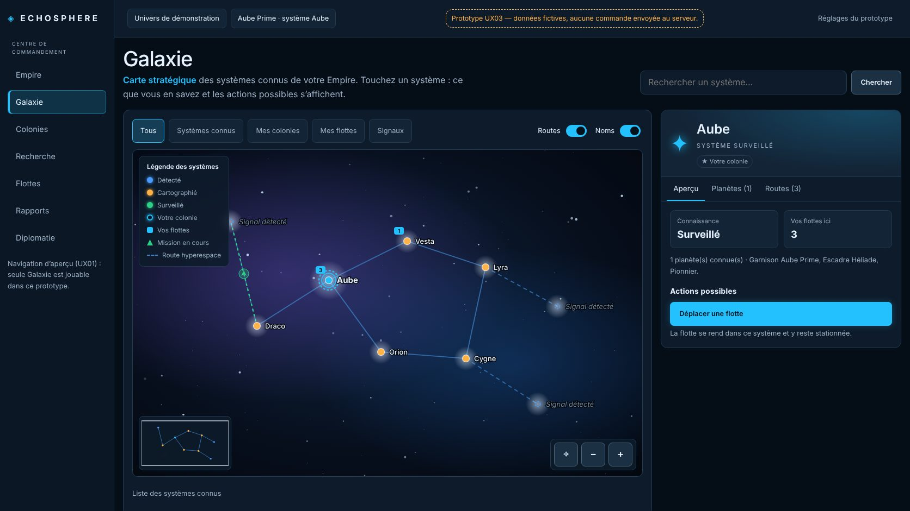
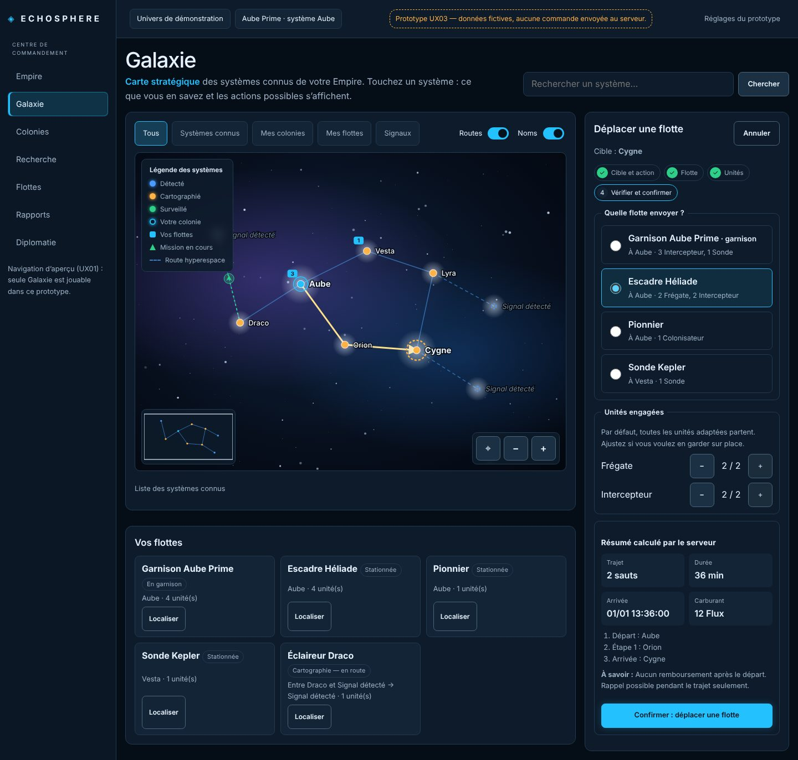
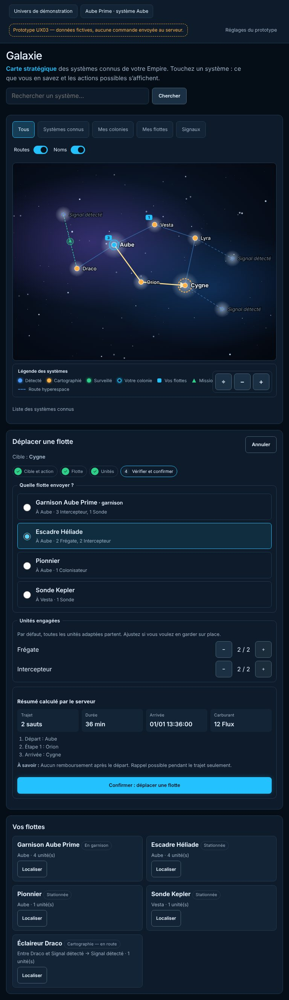
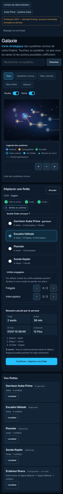
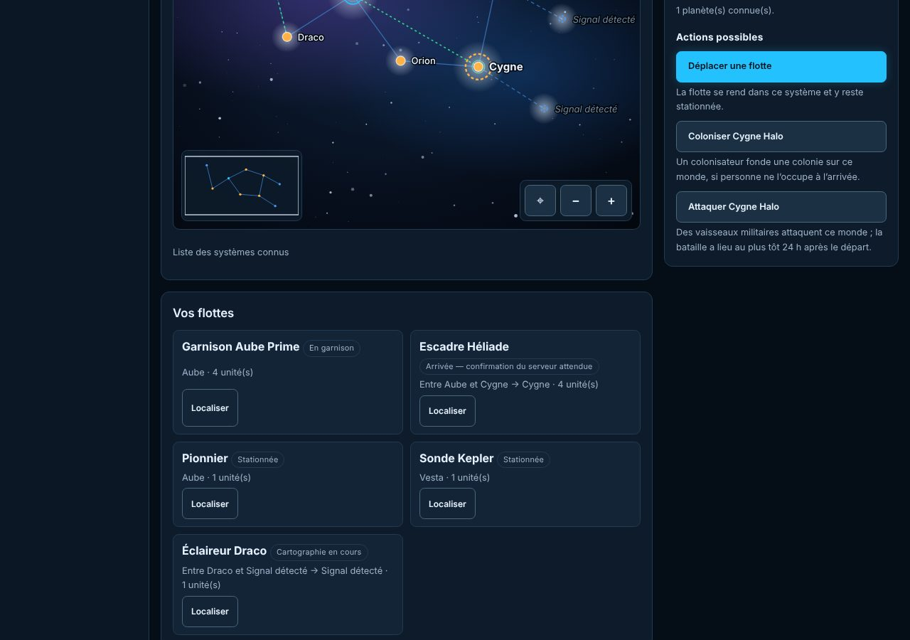

# UX03 — Prototype Galaxie → Flotte → Mission

**Statut : prototype React publié sur `work/ux-redesign` (PR #19, Draft). Données fictives
explicites, isolé du gameplay de production. Tests Vitest exécutés en Fast CI ; parcours vérifié
dans Chromium sur un bundle local (voir §5). Non branché sur l’API Game. Depuis UX04 (03/11/2026),
le prototype réutilise les composants de production de `src/command/` et ne garde que ses fixtures,
son écho local de démonstration et son bandeau : il reste disponible pour comparaison.**

## 1. Lancer

```bash
cd frontend && npm ci
npm run prototype            # ouvre http://localhost:5173/prototype/
npx vitest run src/prototype # tests du prototype
npx playwright test e2e/prototype.spec.ts   # préparé ; nécessite Chromium (npx playwright install chromium)
```

`npm run build` ne contient pas le prototype : Vite ne bâtit que `index.html`, et `src/main.tsx`
n’importe rien de `src/prototype/`.

## 2. Ce que montre le prototype

1. **Sélection** d’un système sur la carte (clic, toucher ou Tab + Entrée) ; une liste des systèmes
   sert d’alternative accessible.
2. **Ce qu’on sait** : signal anonyme (ni nom, ni structure) ou système cartographié (planètes
   connues, vos flottes présentes).
3. **Actions possibles** : Cartographier, Déplacer une flotte, Coloniser <monde>, Attaquer <monde>,
   désactivées avec une raison quand c’est impossible.
4. **Flotte** : cartes radio des flottes éligibles (lieu, unités adaptées) ; présélection si une seule.
5. **Unités** : toutes les unités adaptées par défaut, `−`/`+` ; colonisation = 1 colonisateur.
6. **Trajet** : tracé sur la carte et liste des étapes (mode « extension proposée »), ou ligne
   indicative et nombre de sauts (mode « contrat actuel »).
7. **Résumé serveur** : sauts, durée, arrivée, carburant (aller-retour pour une attaque), bataille,
   « à savoir » (risques connus, textes repris de l’écran Flottes actuel). Recalculé à chaque
   modification ; une réponse obsolète est annulée.
8. **Confirmation** puis **suivi** : message d’état, flotte en mouvement sur la carte (position
   estimée entre les dates du serveur), dock « Vos flottes » (où, quoi, vers où, Localiser). Après
   l’heure d’arrivée : « Arrivée — confirmation du serveur attendue », jamais un résultat inventé.

### Alignement sur la référence `galaxy-map.png` (03/11/2026, demande de l’utilisateur)



Repris de la référence : cadre d’application (barre latérale, barre haute), titre « Galaxie » et
sous-titre « Carte stratégique », recherche, puces de filtre, interrupteurs Routes/Noms, carte sur
fond étoilé et nébuleuses, systèmes lumineux colorés selon la connaissance (Détecté bleu,
Cartographié ambre, Surveillé vert, votre colonie cerclée cyan), routes hyperespace, légende en
surimpression, mini-carte, commandes Recentrer/−/+, panneau de système avec en-tête lumineux,
onglets Aperçu / Planètes / Routes, tuiles d’information et action principale mise en avant.

Volontairement **non repris**, faute de donnée ou de règle de jeu : régions et noms de factions
(« Voile d’Élyndra »…), vue « Influence », filtres Alliés/Neutres/Hostiles par système, distances
en années-lumière, pourcentage d’exploration, statuts de planète comme « Ressources » ou « Habitée »,
boutons Observer/Explorer sans commande correspondante, ressources « totales » de l’Empire. Les
nébuleuses et étoiles de fond sont décoratives (`aria-hidden`), sans signification de jeu. La
recherche ne trouve que les systèmes nommés de l’Empire : un signal n’a pas de nom.

Contrôles de démonstration (menu « Réglages du prototype ») : direction artistique A/B/C, mode du trajet, horloge ×60/×600.

| Bureau (A) | Tablette | Mobile | Suivi |
| --- | --- | --- | --- |
|  |  |  |  |

## 3. Règles respectées

- **Aucune règle métier dupliquée** : trajets, durées, coûts, éligibilité finale et refus viennent de
  la réponse de l’API (ici des réponses fixes écrites à la main). Les actions *proposées* reprennent
  exactement celles de l’écran Flottes actuel (familles d’unités, mondes connus, droits).
- **Fog of War** : fixtures limitées à ce que le serveur enverrait à un Empire ; elles passent les
  validateurs de production `validFleets` et `validProjection` (test). Aucune flotte étrangère,
  aucun nom de signal, aucune route inconnue.
- **Contrats** : types réels (`FleetProjection`, `Projection`, `Quote`, `Plan`, `MissionView`) ; le
  seul ajout est `path` dans `FixtureQuote`, marqué comme proposition UX-API-01.
- **Accessibilité** : systèmes = boutons clavier, focus déplacé sur le titre du panneau, Échap pour
  annuler, `aria-live` sur le résumé, cibles ≥ 44 px, sans survol seul, mouvement réduit respecté.

## 4. Fichiers

| Fichier | Rôle |
| --- | --- |
| `frontend/prototype/index.html`, `src/prototype/main.tsx` | Entrée isolée |
| `src/prototype/PrototypeApp.tsx`, `directions.ts`, `prototype.css` | Bandeau de démonstration, directions B et C conservées pour comparaison |
| `src/prototype/api.ts` | `MissionApi` sur fixtures avec écho local de démonstration (jamais en production) |
| `src/prototype/fixtures.ts` | Données fictives typées (aussi utilisées par les tests) |
| `src/command/*` | Composants de production partagés ([UX04](ux04-live-command-map.md)) |
| `e2e/prototype.spec.ts` | Spec Playwright préparée |

## 5. Vérifications réellement effectuées

- Fast CI de la PR #19 : lint, Vitest (dont `model.test.ts` 8 tests, `CommandMap.test.tsx` 7 tests),
  `tsc -b` + build — voir les runs sur la PR.
- Session cloud : `model.test.ts` exécuté localement via esbuild ; parcours complet joué dans Chromium
  (Playwright Python) sur un bundle esbuild du prototype : clavier, présélection, recalcul, refus,
  Localiser, Fog, mode contrat, suivi ; aucune erreur console ; aucun débordement horizontal à 390,
  768 et 1440 px ; toutes les commandes ≥ 44 px.
- **Non exécuté** : `e2e/prototype.spec.ts` avec le serveur Vite (pas de registre npm dans la session).

## 6. Incrément suivant — fait dans UX04

Le branchement sur les vraies projections derrière un interrupteur est décrit dans
[UX04](ux04-live-command-map.md).
