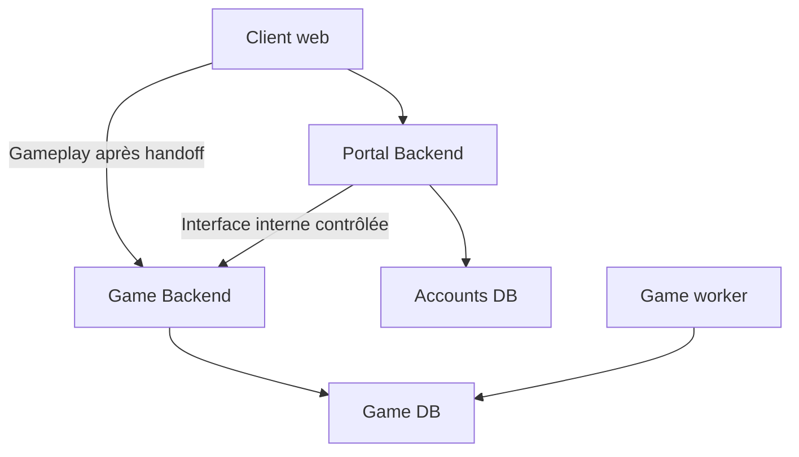

# ADR 0008 — Portal Control Plane / Game Data Plane

- **Statut : Décision validée, architecture cible non implémentée.**
- Date : 2026-10-28 ; source : instruction explicite de la mission de passation.
- Affine [ADR 0001](0001-modular-monolith.md) et [ADR 0006](0006-universe-game-instance.md).
  Ne remplace ni ne renumérote [ADR 0007](0007-colony-economy.md).

**Évolution 5B du 2026-10-29 :** l’utilisateur a depuis validé le login MVP et les limites
temporelles décrites dans [identity-contracts](../03-technical/identity-contracts.md), parties de
Q40–Q44, ainsi que le comportement de déconnexion Q45. Regroupement par appareil et protocoles
restent ouverts. Les passages ci-dessous indiquant des durées/login non choisis décrivent
la décision de plateforme du 28/10 ; les nouvelles décisions les précisent sans choisir les
formats, la crypto, le stockage ou les mécanismes de Q46–Q56. Aucune implémentation ajoutée.
Complément Q40/Q49 : récupération 30 min/unique, réémission et effets du reset validés ;
Flux email sans MFA également validé : double confirmation/pending, notifications et réauthentification.
Demande email unique 1 h absolue, remplacement complet et révocation globale après succès validés.
Q49 reste partiellement ouverte (fournisseur/livraison et mécanismes). Variante MFA sous Q48 non livrée ; sans accès ancien, pas de bypass mot de passe seul.

## Contexte et décision

Un compte Echosphere est global et peut participer à plusieurs parties simultanément. Parcours cible :
landing publique → inscription/connexion → espace compte/lobby → liste des parties → créer/rejoindre
→ sélectionner un Universe → Game UI. User → UniverseMembership → Universe → éventuellement
Empire/rôle/permissions. Un utilisateur pourra avoir un empire différent dans chaque univers ;
le partage d’empire reste Q21. Empire.owner_user_id n’est pas le modèle unique de participation.
Aucun compte, membership ou mécanisme d’authentification n’est créé par cet ADR.

La plateforme cible a **deux applications backend indépendantes et isolables**, chacune en monolithe
modulaire. Le backend actuel est le futur Game Backend. Les domaines gameplay ne deviennent pas
10–20 microservices. La frontière Portal/Game est justifiée par exposition, sécurité et disponibilité.

| Application future | Responsabilités | Stockage autoritaire propre |
| --- | --- | --- |
| Portal / Control Plane | Landing et APIs de compte, inscription/login/récupération, compte, lobby/liste/création/join, invitations, cycle de vie global des memberships, administration du compte | Accounts DB |
| Game / Game Data Plane | Universe, Empire, Colony, économie/construction, puis recherche/galaxie/exploration/flottes/combat/IA, événements et état autoritaire des parties | Game DB |

Après entrée dans une partie, le client adresse ses requêtes gameplay **directement au Game Backend**.
Le Portal n’est ni un proxy de chaque commande ni une dépendance d’autorisation consultée à chaque tour.

## Bases et frontière de confiance

Accounts DB pourra porter users, credentials/password hashes, sessions Portal, MFA, récupération et
informations globales de lobby/membership. Game DB ne porte **jamais les credentials**. Elle ne
conservera que les références et droits nécessaires : global_user_id, universe_id, membership/access id,
empire_id éventuel, role et status. Noms, types, tables et autorité de synchronisation restent à
spécifier en 5B ; aucune migration n’est autorisée par ce diagramme. Pas de FK SQL inter-bases supposée.

**Portal ne doit jamais écrire directement dans Game DB**, même pour provisionner un univers,
rejoindre une partie ou associer un empire. Provision/grant/revoke/join passent par une interface
interne du Game Backend : authentification service-to-service, idempotence, validation et scope
explicites ; elle n’est pas une route publique normale. Réseau privé, mTLS, signatures ou credentials
de service restent des possibilités, pas des protocoles choisis. La disponibilité de l’interface ne
remplace pas l’autorisation : seul un appel interne authentifié et autorisé peut demander un effet.
Livraison, ordre, retries, réconciliation et droits effectifs sont à cadrer en Q46/Q53/Q54.

## Handoff et autonomie de GameSession

**Orientation validée, format et protocole non décidés** :

1. L’utilisateur authentifié au Portal sélectionne un Universe auquel il peut accéder.
2. Le Portal émet un ticket très court, à usage unique, destiné au Game Backend.
3. Le client est redirigé vers Game, qui vérifie l’authenticité, l’expiration, l’audience, le scope
   et l’absence de rejeu selon le contrat à définir.
4. Game établit sa propre GameSession ; les commandes passent ensuite par Game et ses contrôles locaux.

Contenu conceptuel : global user id, universe id, membership id, rôle éventuel, expiration courte,
nonce, audience Game. Aucun JWT/OAuth/mTLS, algorithme, TTL chiffré, cookie ou route n’est sélectionné
ici. Modalités d’usage unique, clés, rotation et état temporaire restent Q42/Q56.
Chaque commande Game devra encore vérifier session, accès/membership/univers, permissions/empire,
propriété des entités et fog ; un ticket, un UUID ou controller_type human/ai n’est pas une permission
universelle. Ne pas appeler Portal/Accounts DB à chaque commande.

Une GameSession déjà établie doit permettre de continuer à jouer pendant une indisponibilité
momentanée du Portal. Durée, expiration, refresh, révocation et logout ne sont pas résolus par ce
principe : Q43–Q45/Q52/Q54 doivent définir et tester leur compatibilité avec cette autonomie.
Aucune promesse de session infinie, de refresh disponible ou de révocation instantanée n’est déduite.

## Résilience et isolation opérationnelle

Une surcharge, attaque ou panne Portal peut empêcher temporairement login, création/join et nouvelles
entrées de partie. Elle ne doit pas arrêter les workers Game, univers, production et événements,
ni faire tomber les sessions Game déjà établies dans les limites du contrat retenu.

Les deux backends doivent pouvoir disposer de CPU/RAM, pools, scaling, bases et limites réseau
**distincts**. Des modules séparés partageant un processus, un pool ou une base ne prouvent pas cette
isolation. Une machine commune en développement est permise, pas imposée en déploiement. Une
séparation applicative seule ne protège pas d’une panne d’hôte ou saturation du réseau partagé ;
placement et budgets de résilience devront être validés, sans promettre une immunité DDoS.

Portal est la principale surface publique compte/lobby : bots, brute force, scraping, spam et DDoS
applicatif. Protections futures indépendantes possibles : CDN/WAF, rate limiting, anti-bot,
challenge/CAPTCHA si utile, limites IP/compte, protection brute force, email verification et Redis
pour état temporaire. Aucune n’est implémentée ici ni autorité gameplay. Game devra également protéger
son ingress et ses autorisations ; il n’est pas sûr par sa seule séparation du Portal.

## État réel et séquencement

**Implémenté aujourd’hui** : un backend gameplay FastAPI, worker du même code, PostgreSQL Game,
frontend React et service de migration ; aucun Portal, Accounts DB, compte, ticket ou GameSession.
Le Compose actuel reste inchangé. Le futur environnement local pourra partager une machine et
héberger Portal frontend/backend/Accounts PostgreSQL et Game frontend/backend/worker/Game PostgreSQL ;
ceci reste une cible documentaire, pas une commande de lancement actuelle.

5A : domaine Colony. Puis 5B : architecture identité et contrats Portal/Game ; 5C : fondation minimale
compte/lobby selon cadrage ; 5D : API Colony sécurisée et UI réelle. Pas de Portal complet ou
multijoueur développé par anticipation. Q16 est partiellement cadrée par cet ADR, pas fermée.

## Conséquences et critères futurs

Préserver les transactions de Game, UTC, PostgreSQL autoritaire, scheduler, snapshots et interfaces
humain/IA communes. Isoler secrets et connexions des deux plans. Tester ultérieurement : Portal
arrêté/saturé avec worker Game en progrès et sessions établies utilisables ; absence de dépendance
Portal par commande ; ticket expiré/rejoué/mauvaise audience/univers refusé ; appels internes non
autorisés refusés ; retries sans double grant/provision ; suspension/révocation selon contrat explicite.
Ces scénarios sont des critères à construire, **pas des tests exécutés** dans cette mission.

- [Architecture](../03-technical/architecture.md) · [Sécurité](../03-technical/security.md)
- [Q16 et Q40–Q56](../05-project/open-questions.md) · [Provenance](../06-handoff/source-map.md)
