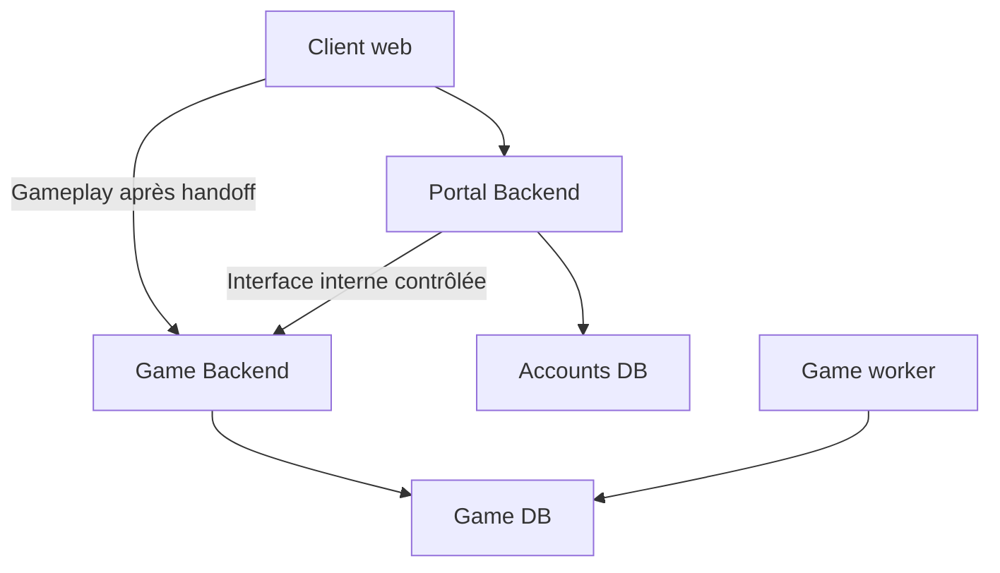

# ADR 0008 — Portal Control Plane / Game Data Plane

- **Statut : Décision validée ; réalisation partielle C01–C08 sur PR #7, non intégrée à master.**
- Date : 2026-10-28 ; source : instruction explicite de la mission de passation.
- Affine [ADR 0001](0001-modular-monolith.md) et [ADR 0006](0006-universe-game-instance.md).
  Ne remplace ni ne renumérote [ADR 0007](0007-colony-economy.md).

**Complément validé 5B du 2026-10-29 :** les
[contrats identité/Portal-Game](../03-technical/identity-contracts.md) précisent désormais cette
architecture : sessions opaques, ticket signé asymétriquement/local, mTLS privé, synchronisation
outbox/idempotence/révisions, révocations ciblées et règles compte/MFA. Bloc final validé avec
corrections MFA sans global systématique, plafonds de sessions configurables et CORS refusé par défaut.
Le [registre Q40–Q56](../05-project/open-questions.md) distingue clôtures 5B, détails délégués et reports
support/email/modes. L’ADR garde sa provenance du 28/10, sans laisser ses anciens points ouverts
contredire le complément validé. Aucune implémentation ajoutée par ce complément documentaire.
[C06](../03-technical/portal-game-control.md) matérialise désormais lobby/interface mTLS et droits ;
[C07](../03-technical/game-handoff.md) matérialise handoff/GameSession. Les décisions de cet ADR restent inchangées.

## Contexte et décision

Un compte Echosphere est global et peut participer à plusieurs parties simultanément. Parcours cible :
landing publique → inscription/connexion → espace compte/lobby → liste des parties → créer/rejoindre
→ sélectionner un Universe → Game UI. User → UniverseMembership → Universe → éventuellement
Empire/rôle/permissions. Un utilisateur pourra avoir un empire différent dans chaque univers ;
le partage d’empire reste Q21. Empire.owner_user_id n’est pas le modèle unique de participation.
Aucun compte, membership ou mécanisme d’authentification n’est créé par cet ADR.

La plateforme cible a **deux applications backend indépendantes et isolables**, chacune en monolithe
modulaire. Le backend actuel est le futur Game Backend. Les domaines gameplay ne deviennent pas
10–20 microservices. La frontière Portal/Game est justifiée par exposition, sécurité et disponibilité.

| Application future | Responsabilités | Stockage autoritaire propre |
| --- | --- | --- |
| Portal / Control Plane | Landing et APIs de compte, inscription/login/récupération, compte, lobby/liste/création/join, invitations, cycle de vie global des memberships, administration du compte | Accounts DB |
| Game / Game Data Plane | Universe, Empire, Colony, économie/construction, puis recherche/galaxie/exploration/flottes/combat/IA, événements et état autoritaire des parties | Game DB |

Après entrée dans une partie, le client adresse ses requêtes gameplay **directement au Game Backend**.
Le Portal n’est ni un proxy de chaque commande ni une dépendance d’autorisation consultée à chaque tour.

## Bases et frontière de confiance

Accounts DB pourra porter users, credentials/password hashes, sessions Portal, MFA, récupération et
informations globales de lobby/membership. Game DB ne porte **jamais les credentials de compte Portal**. Elle ne
conservera que les références et droits nécessaires : global_user_id, universe_id, membership/access id,
empire_id éventuel, role et status. Portal possède l’intention, Game l’accès effectif selon le contrat
5B ; noms/types/tables relèvent du détail délégué aux lots dépendants. Aucune migration autorisée par
ce diagramme. Pas de FK SQL inter-bases supposée.

**Portal ne doit jamais écrire directement dans Game DB**, même pour provisionner un univers,
rejoindre une partie ou associer un empire. Provision/grant/revoke/join passent par une interface
interne du Game Backend : authentification service-to-service, idempotence, validation et scope
explicites ; elle n’est pas une route publique normale. Le complément 5B retient réseau privé et mTLS,
autorisation par service/opération, outbox, idempotence, révisions ordonnées et réconciliation.
La disponibilité ne remplace pas l’autorisation ; schémas, PKI et mécanismes de déploiement sont
délégués à 5C/5D, avec recette avant utilisation.

## Handoff et autonomie de GameSession

**Contrat validé ; implémentation C07 sur PR #7, détails dans le canonique 5B** :

1. L’utilisateur authentifié au Portal sélectionne un Universe auquel il peut accéder.
2. Le Portal émet un ticket très court, à usage unique, destiné au Game Backend.
3. Le client est redirigé vers Game, qui vérifie l’authenticité, l’expiration, l’audience, le scope
   et l’absence de rejeu selon le contrat 5B, avec liaison navigateur et consommation atomique.
4. Game établit sa propre GameSession ; les commandes passent ensuite par Game et ses contrôles locaux.

Contenu lié au compte/appareil, membership/univers, destination, échéance et état navigateur ; les
permissions restent locales à Game. Ticket signé asymétriquement 60 s/unique, pré-auth 5 min, clés
publiques prédistribuées, clé inconnue refusée localement. Format/algorithme, claims détaillés et
rotation concrète sont délégués ; aucune nouvelle route créée par l’ADR.
Chaque commande Game devra encore vérifier session, accès/membership/univers, permissions/empire,
propriété des entités et fog ; un ticket, un UUID ou controller_type human/ai n’est pas une permission
universelle. Ne pas appeler Portal/Accounts DB à chaque commande.

Une GameSession déjà établie doit permettre de continuer à jouer pendant une indisponibilité
momentanée du Portal : Game 8 h absolues/2 h inactif, accès au plus 8 h depuis confirmation Portal,
sans glissement ni reset en panne. Portal 7 j absolus/72 h inactif ; seule activité explicite classée
serveur comptée. Révocation reçue immédiate, distante persistée jusqu’à acquittement avec UI fidèle.
Renouvellement par Portal disponible et nouveau handoff ; pas de session infinie ni promesse distante
instantanée. Portées et scénarios Q43–Q45/Q52/Q54 cadrés par 5B, preuves futures en 5C/5D.

## Résilience et isolation opérationnelle

Une surcharge, attaque ou panne Portal peut empêcher temporairement login, création/join et nouvelles
entrées de partie. Elle ne doit pas arrêter les workers Game, univers, production et événements,
ni faire tomber les sessions Game déjà établies dans les limites du contrat retenu.

Les deux backends doivent pouvoir disposer de CPU/RAM, pools, scaling, bases et limites réseau
**distincts**. Des modules séparés partageant un processus, un pool ou une base ne prouvent pas cette
isolation. Une machine commune en développement est permise, pas imposée en déploiement. Une
séparation applicative seule ne protège pas d’une panne d’hôte ou saturation du réseau partagé ;
placement et budgets de résilience devront être validés, sans promettre une immunité DDoS.

Portal est la principale surface publique compte/lobby : bots, brute force, scraping, spam et DDoS
applicatif. Protections futures indépendantes possibles : CDN/WAF, rate limiting, anti-bot,
challenge/CAPTCHA si utile, limites IP/compte, protection brute force, email verification et Redis
pour état temporaire. Aucune n’est implémentée ici ni autorité gameplay. Game devra également protéger
son ingress et ses autorisations ; il n’est pas sûr par sa seule séparation du Portal.

## État réel et séquencement

**État intégré par 5B** : un backend gameplay FastAPI, worker, PostgreSQL Game, frontend React et
service de migration, sans Portal/auth. **Complément C01 sur PR #7** : socle Portal/Accounts et
HTTPS local, sans compte, ticket ni GameSession ; [recette](../03-technical/portal-foundation.md).
Le Compose est étendu au titre du lot 5C explicitement autorisé. Le futur environnement local pourra partager une machine et
héberger Portal frontend/backend/Accounts PostgreSQL et Game frontend/backend/worker/Game PostgreSQL ;
ceci reste une cible documentaire, pas une commande de lancement actuelle.

5A : domaine Colony. Puis 5B : architecture identité et contrats Portal/Game ; 5C : fondation minimale
compte/lobby selon cadrage ; 5D : API Colony sécurisée et UI réelle. Pas de Portal complet ou
multijoueur développé par anticipation. Q16 a son cadrage 5B clos ; réalisation et reports restent
explicites au registre. 5B documentaire terminé et intégré à master via PR #6 (`63bb7d1`),
contrats implémentés partiellement depuis par C02–C08 sur PR #7. 5C est le lot courant autorisé, sans début de 5D.

## Conséquences et critères futurs

Préserver les transactions de Game, UTC, PostgreSQL autoritaire, scheduler, snapshots et interfaces
humain/IA communes. Isoler secrets et connexions des deux plans. Tester ultérieurement : Portal
arrêté/saturé avec worker Game en progrès et sessions établies utilisables ; absence de dépendance
Portal par commande ; ticket expiré/rejoué/mauvaise audience/univers refusé ; appels internes non
autorisés refusés ; retries sans double grant/provision ; suspension/révocation selon contrat explicite.
Ces scénarios sont des critères à construire, **pas des tests exécutés** dans cette mission.

- [Architecture](../03-technical/architecture.md) · [Sécurité](../03-technical/security.md)
- [Q16 et Q40–Q56](../05-project/open-questions.md) · [Provenance](../06-handoff/source-map.md)
